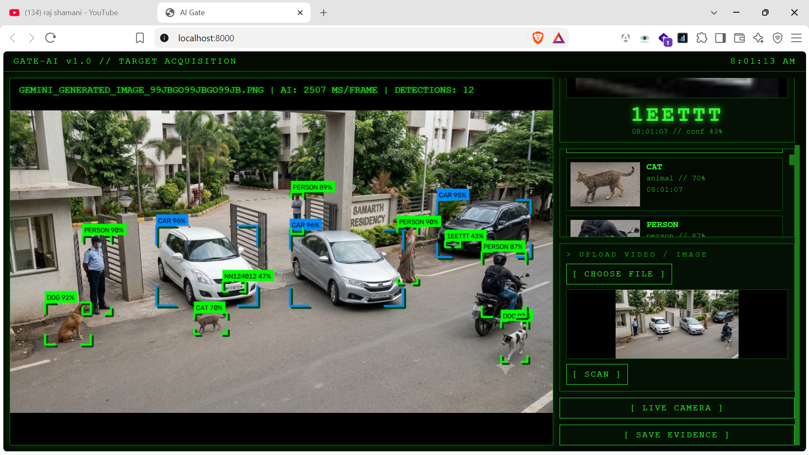

# AI Gatekeeper

**AI-Powered Gate Security System**



AI Gatekeeper is a Python-based computer vision system designed to detect vehicles, animals, and vehicle license plates from camera frames and input images.

The system processes camera input, performs object and license plate detection, generates annotated images, and stores detection evidence for further analysis.

## 1. Project Overview

The system uses two computer vision models:

- **Hugging Face RT-DETR:** Detects vehicles and animals using the COCO object detection dataset.
- **License Plate Detector:** Uses a locally stored Hugging Face model checkpoint (`best.pt`) to detect vehicle license plates.

Detected license plates are cropped and saved as evidence. The system also generates annotated images and event JSON files containing detection information.

## 2. Features

| Feature | Status |
|---|---|
| Camera frame acquisition | Implemented |
| Vehicle detection | Implemented |
| Animal detection | Implemented |
| License plate detection | Implemented |
| License plate cropping | Implemented |
| Annotated image generation | Implemented |
| Evidence storage | Implemented |
| Event JSON generation | Implemented |
| License plate OCR | Not implemented |
| Face detection | Not implemented |
| Database integration | Not implemented |
| Web UI / Dashboard | Not implemented |

## 3. Technology Stack

- **Programming Language:** Python
- **Object Detection:** Hugging Face RT-DETR
- **License Plate Detection:** Custom / cloned Hugging Face detector
- **Computer Vision:** OpenCV
- **Model Weights:** Local `best.pt` checkpoint
- **Configuration:** Environment variables (`.env`)
- **Testing:** Pytest

## 4. Prerequisites

Before running the project, ensure you have:

- Python installed.
- Git installed.
- A compatible camera or phone camera stream URL for live camera processing.
- Access to the required model weights.
- Internet access for downloading dependencies or model files when required.

## 5. Installation and Setup

Run these commands in PowerShell from the project directory.

**Create a virtual environment:**

```powershell
python -m venv .venv
```

**Activate the virtual environment:**

```powershell
.\.venv\Scripts\Activate.ps1
```

**Install dependencies:**

```powershell
pip install -r requirements.txt
```

**Configure environment variables:**

```powershell
Copy-Item .env.example .env
```

Edit `.env` and configure the required values, including `PLATE_WEIGHTS` and `CAMERA_URL`.

## 6. Running the Project

**Check the environment:**

```powershell
python scripts\check_env.py
```

**Process phone camera frames:**

```powershell
python scripts\run_phone.py --frames 30
```

**Process images from a directory:**

```powershell
python scripts\run_images.py C:\test_images
```

**Run tests:**

```powershell
pytest tests
```

## 7. Detection Evidence

The system generates detection evidence inside:

```text
output/<event_id>/
```

Generated evidence includes:

- Original input image
- Annotated image with detection results
- Cropped license plate images
- `event.json` containing event and detection information

## 8. Current Limitations

The current implementation focuses on object detection, license plate detection, and evidence generation.

The following capabilities are not currently implemented:

- Optical Character Recognition (OCR) for reading license plate numbers.
- Face detection.
- Database integration.
- Web-based monitoring dashboard.

## 9. Repository

**GitHub:** https://github.com/codexprashantpawar/AI-Gatekeeper
